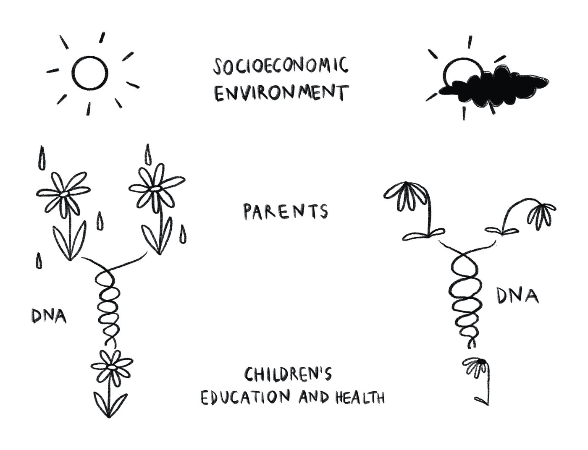
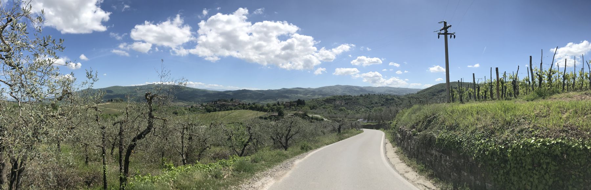

I'm a postdoctoral researcher at the [WZB Berlin Social Science Center](https://www.wzb.eu/de/personen/gaia-ghirardi) and the [Einstein Center Population Diversity (ECPD)](https://einstein-diversity.com/team-member/gaia-ghirardi/). I will be [Marie Skłodowska-Curie](https://marie-sklodowska-curie-actions.ec.europa.eu) postdoctoral fellow at the University of Oxford from September 2027. I received my PhD from the European University Institute (EUI) in 2025.

My research aims to understand the intergenerational transmission of education and health outcomes from parents to children, also using molecular genetic data. My works have been published in _Demography_, _Social Science & Medicine_, _European Sociological Review_, _Social Science Research_, _Research in Social Stratification and Mobility_, and _Acta Sociologica_.

### Research fields

- Social stratification
- Educational and health inequalities
- Sociogenomics
- Early childhood

<figure>
  
  <figcaption>Illustration by Giuditta Furlan – <a href="mailto:giudittafurlan@gmail.com">giudittafurlan@gmail.com</a></figcaption>
</figure>

{: .wide-photo width="1800" height="583"}
